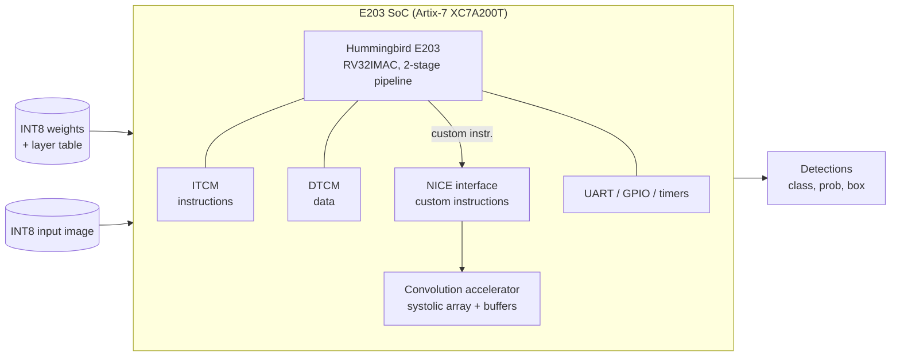
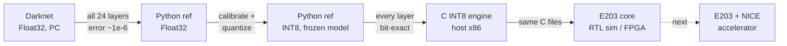
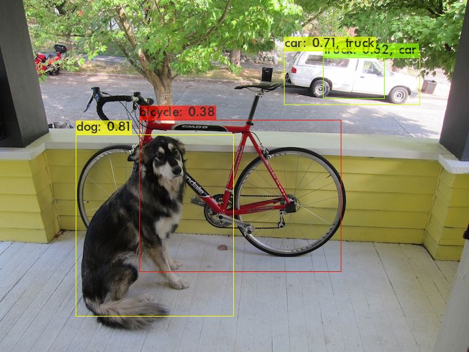
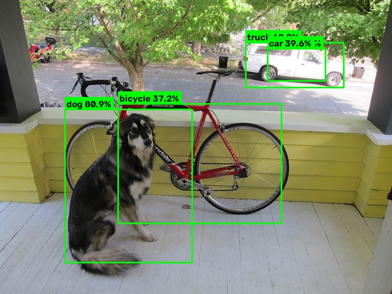
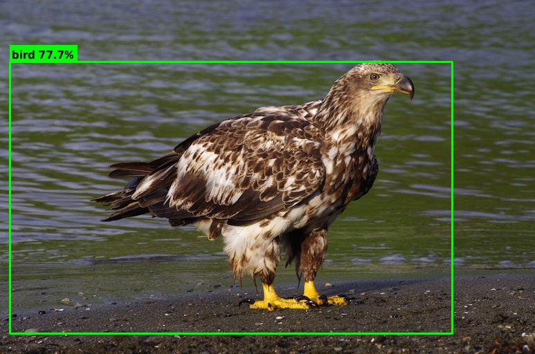
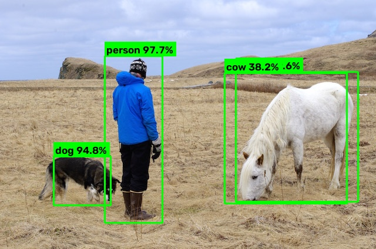

# RISC-V-Based YOLOv3-Tiny Hardware Acceleration on FPGA

Object detection (YOLOv3-tiny, INT8) running on the open-source **Hummingbird E203 RISC-V**
core, with the convolution layers offloaded to a custom **systolic-array accelerator** attached
through the E203's **NICE** custom-instruction interface, targeting a Xilinx **Artix-7
XC7A200T** FPGA.

**Graduation project, Electronics and Communications Engineering, Faculty of Engineering, Cairo
University, Class of 2027 (EECE27).**

| | |
|---|---|
| **Team** | Mohamed Karam, Mohamed Amr, Youssef Sameh, Ahmed Bahaa, Abdelrahman Mohy, Ahmed Abdelmonem |
| **Supervisor** | Dr. Omar Nasr |
| **Mentors** | Eng. Dina Saad, Eng. Mahmoud Samy |
| **Base paper** | *RISC-V-based YOLOv3-tiny acceleration with runtime-reconfigurable systolic arrays and custom instructions* ([docs/](docs/)) |

---

## Table of contents

1. [Why this project](#1-why-this-project)
2. [System architecture](#2-system-architecture)
3. [Project stages and status](#3-project-stages-and-status)
4. [Verification chain](#4-verification-chain)
5. [Results so far](#5-results-so-far)
6. [Repository layout](#6-repository-layout)
7. [Getting started](#7-getting-started)
8. [Running the host INT8 pipeline](#8-running-the-host-int8-pipeline)
9. [Running code on the E203 RISC-V core](#9-running-code-on-the-e203-risc-v-core)
10. [Key design decisions](#10-key-design-decisions)
11. [Tools and tested versions](#11-tools-and-tested-versions)
12. [Documentation index](#12-documentation-index)
13. [Known limitations and files not in the repo](#13-known-limitations-and-files-not-in-the-repo)
14. [Roadmap](#14-roadmap)
15. [Working with this repository (git)](#15-working-with-this-repository-git)
16. [References](#16-references)

---

## 1. Why this project

Running YOLOv3-tiny in pure software on a small embedded RISC-V core is too slow for real-time
use. Measurements from the base paper on a plain E203:

| Metric | Software only (E203) | With the paper's accelerator |
|---|---|---|
| Time per frame | 52.84 ms (18.9 FPS) | 22.55 ms (44.4 FPS), **2.34×** end-to-end |
| Convolution | ~63% of the frame time | **4.89×** faster (3.33M → 0.68M cycles) |
| Sorting / IoU (post-processing) | — | 2.54× / 1.83× faster cycles |

Convolution latency by architecture (paper, Table 9): E203 software 33.25 ms, adder tree
11.24 ms, systolic array 9.41 ms, Eyeriss 9.14 ms, **paper's design 6.80 ms**.

**Goal:** reproduce this kind of speed-up on our own design: keep control flow on the RISC-V
CPU and move the heavy multiply-accumulate work into hardware.

---

## 2. System architecture



**Split of work:**

| E203 CPU (software) | Accelerator via NICE (hardware) |
|---|---|
| Control flow, layer sequencing | Convolution multiply-accumulate (systolic array) |
| Route and upsample layers | Data reuse in on-chip buffers |
| YOLO decode + NMS (integer only, lookup tables) | Optional: sorting / IoU units |
| Issues custom instructions over NICE | |

Batch-norm is folded into the convolution weights offline, so neither side computes it at run time.

---

## 3. Project stages and status

| # | Stage | Tools | Output | Status |
|---|---|---|---|---|
| 1 | **Reference inference** | Darknet (AlexeyAB), GCC, Python | Reference detections + feature maps | ✅ Done |
| 2 | **Golden vectors** | Darknet dumps, Python + NumPy, C | INT8 inputs, weights, biases, expected outputs per layer | ✅ Done |
| 3 | **Software baseline on the E203** | RISC-V GCC, Hummingbird SDK, Icarus/Verilator | Inference time, cycles, detections on the E203 | 🟡 In progress: E203 flow working (1+1, 2D convolution); full C INT8 engine port is next |
| 4 | **RTL accelerator** | Verilog / SystemVerilog, ModelSim / Verilator, cocotb (optional) | Verified MAC/PE, systolic array, buffers | ⬜ Planned |
| 5 | **Integration and evaluation** | Vivado, Hummingbird SDK, Python | mAP, latency, FPS, LUT/FF/BRAM/DSP | ⬜ Planned |

---

## 4. Verification chain

Every step is checked against the step before it, so a mismatch is caught where it is introduced.



1. **Python Float32 = Darknet:** all 24 layers match (relative error 1e-7 to 3e-6).
2. **C INT8 = Python INT8:** every layer is bit-exact.
3. **C decode + NMS = Python:** same detections, probability difference 0.0000.
4. **E203:** the bare-metal flow is proven with small programs; the C INT8 engine is the next to run there.

---

## 5. Results so far

### 5.1 Host-side INT8 detection (C engine vs. Darknet Float32)

| Image | Darknet Float32 | Our C engine, INT8 | C vs. Python INT8 |
|---|---|---|---|
| `dog.jpg` | dog 0.81, bicycle 0.38, car 0.71, truck | dog 80.9%, bicycle 37.2%, car 39.6%, truck | ✅ `ALL LAYERS BIT-EXACT`, `PASS` (6/6 matched) |
| `eagle.jpg` | bird 0.76 | bird 77.7%, almost the same box | ✅ `ALL LAYERS BIT-EXACT`, `PASS` (1/1 matched) |
| `person.jpg` | person 0.98, dog 0.89, sheep 0.83 | person 97.7%, dog 94.8%, cow 38.2% (horse is a weak class for this model) | see [workflow doc §11](docs/yolov3_tiny_int8_workflow.md) |

<table>
<tr>
<td align="center"><b>Darknet Float32 (dog)</b><br/></td>
<td align="center"><b>Our C engine, INT8 (dog)</b><br/></td>
</tr>
<tr>
<td align="center"><b>C engine, INT8 (eagle)</b><br/></td>
<td align="center"><b>C engine, INT8 (person)</b><br/></td>
</tr>
</table>

**C engine memory footprint:** INT8 weights 8.44 MiB (external), feature-map arena 3.30 MiB,
INT8 input image 0.50 MiB.

> Host timings are measured on the x86 PC and are **not** E203 performance numbers.

### 5.2 Running on the E203 RISC-V core (RTL simulation)

Programs compiled with the Nuclei RISC-V GCC + Hummingbird SDK and run on the E203 Verilog RTL
in Icarus Verilog. Full write-up: [docs/E203_SIMULATION_REPORT.md](docs/E203_SIMULATION_REPORT.md).

| Program | Result | Whole run | Measured section (`mcycle` / `minstret`) |
|---|---|---|---|
| `1 + 1` | ✅ `TEST_PASS` | 4,410 cycles, 23 instructions | — |
| 5×5 image * 3×3 kernel convolution | ✅ `PROGRAM PASS`, output `63 72 81 / 108 117 126 / 153 162 171` | 350,309 cycles | **Convolution: 2,306 cycles, 836 instructions** |

- 81 multiply-accumulates take 2,306 cycles, about **28 cycles per MAC** in software. The E203
  multiplier is multi-cycle, which is exactly the cost the accelerator is meant to remove.
- Printing the 3×3 result with `printf` takes 85,219 cycles, 37× more than the math. So
  whole-run cycle counts mostly measure startup and printing. **Use the section counters when
  comparing hardware against software.**

---

## 6. Repository layout

```
riscv-yolo-accelerator/
├── README.md                          this file
├── docs/
│   ├── yolov3_tiny_int8_workflow.md   host workflow: Darknet → Python → C (step-by-step commands)
│   ├── E203_SIMULATION_REPORT.md      running C on the E203 RTL: steps, problems, fixes, results
│   ├── GP_Progress_RISCV_YOLOv3tiny.pdf   progress report (slides)
│   └── RISC-V-based YOLOv3-tiny acceleration ... .pdf   base paper
├── software/
│   ├── reference/
│   │   ├── darknet/                   AlexeyAB Darknet source + DUMP_DIR hook in src/network.c
│   │   ├── python/yolov3_tiny_ref.py  golden reference: Float32 + INT8, calibration, export, compare
│   │   └── results/                   Darknet + Python dumps (dog, eagle, person) and the exported INT8 model
│   │       └── python_int8_dog/model/ weights_q.bin, bias_i32.bin, layers.json, layers.h
│   ├── c_inference/                   bare-metal C99 INT8 engine (no malloc, no libm, no OS)
│   │   ├── src/                       yolo_int8.c (forward pass), yolo_decode.c (LUT decode + NMS)
│   │   ├── include/                   public headers
│   │   ├── tests/                     host test harness, detection compare + visualization scripts
│   │   ├── tools/                     gen_decode_tables.py (sigmoid/exp lookup tables)
│   │   └── results/                   C detections and visualizations
│   ├── e203_baremetal/                programs for the E203 core (see its README)
│   │   ├── add/                       1 + 1 with a minimal startup file
│   │   └── conv2d_sim/                5×5 * 3×3 convolution with cycle counters (Hummingbird SDK)
│   └── datasets/coco2017/             200 COCO val2017 calibration images + selection script
├── verification/
│   └── e203_sim/                      run.sh, tb_monitor.v, GTKWave view for the E203 RTL
└── hardware/                          RTL for the accelerator (to be added)
```

---

## 7. Getting started

### 7.1 Requirements

| Needed for | What |
|---|---|
| Everything | Ubuntu 22.04 (tested in a VM), `git`, `make`, `gcc` |
| Python reference + scripts | Python 3 with **NumPy** and **Pillow** (`pip install numpy pillow`) |
| Darknet reference | `yolov3-tiny.cfg`, `yolov3-tiny.weights`, `coco.names`, test images (see [§13](#13-known-limitations-and-files-not-in-the-repo)) |
| E203 programs | Nuclei RISC-V GCC 2020.08, `hbird-sdk`, `e203_hbirdv2`, Icarus Verilog, GTKWave |

```bash
sudo apt install -y git build-essential python3-pip iverilog gtkwave
pip install numpy pillow
```

### 7.2 Clone

```bash
cd ~
git clone https://github.com/gradproject-27/riscv-yolo-accelerator.git
cd riscv-yolo-accelerator
```

All commands below assume the repo is at `~/riscv-yolo-accelerator`.

---

## 8. Running the host INT8 pipeline

Full commands and expected outputs are in
**[docs/yolov3_tiny_int8_workflow.md](docs/yolov3_tiny_int8_workflow.md)**. In short:

```bash
# 1. Build the patched Darknet and dump every layer (Float32)
cd ~/riscv-yolo-accelerator/software/reference/darknet
make GPU=0 CUDNN=0 OPENCV=0
DUMP_DIR="$PWD/../results/darknet_float32_dog" ./darknet detector test \
    cfg/coco.data cfg/yolov3-tiny.cfg yolov3-tiny.weights data/dog.jpg -dont_show -thresh 0.25

# 2. Python: calibrate once, quantize, export the INT8 model
cd ../python
python3 yolov3_tiny_ref.py run --cfg ../darknet/cfg/yolov3-tiny.cfg \
    --weights ../darknet/yolov3-tiny.weights --image ../darknet/data/dog.jpg \
    --input-bin ../results/darknet_float32_dog/input.bin --names ../darknet/data/coco.names \
    --calib-dir ../../datasets/coco2017/calib_images --bits 8 --out ../results/python_int8_dog

# 3. C INT8 engine: run and check every layer is bit-exact against Python
cd ../../c_inference
make test MODEL=../reference/results/python_int8_dog/model \
          INPUT=../reference/results/python_int8_dog/int8/input.bin \
          REF=../reference/results/python_int8_dog/int8
# expected: ALL LAYERS BIT-EXACT
```

The exported INT8 model in `software/reference/results/python_int8_dog/model/` is already in the
repo, so step 3 can be run on its own. For a new image, run `yolov3_tiny_ref.py infer-int8`
with the **same** frozen model (do not recalibrate).

---

## 9. Running code on the E203 RISC-V core

Full write-up with every problem we hit and how it was solved:
**[docs/E203_SIMULATION_REPORT.md](docs/E203_SIMULATION_REPORT.md)**.

### 9.1 One-time setup

```bash
# Hummingbird SDK and E203 RTL, pinned to the tested commits
git clone https://github.com/riscv-mcu/hbird-sdk.git ~/hbird-sdk
git -C ~/hbird-sdk checkout 0e0e9083569721578c42f07a95b05a26c0760db6
git clone https://github.com/riscv-mcu/e203_hbirdv2.git ~/e203_hbirdv2
git -C ~/e203_hbirdv2 checkout 9f3e34f337f5d0a1236a285871ffa2032491617a
cd ~/e203_hbirdv2/vsim && make install          # run only once

# Nuclei RISC-V GCC 2020.08 (GCC 9.2) into ~/Nuclei/gcc
mkdir -p ~/Nuclei && cd ~/Nuclei
wget https://download.nucleisys.com/upload/files/toolchain/gcc/nuclei_riscv_newlibc_prebuilt_linux64_2020.08.tar.bz2
tar xjf nuclei_riscv_newlibc_prebuilt_linux64_2020.08.tar.bz2 && rm nuclei_riscv_newlibc_prebuilt_linux64_2020.08.tar.bz2
echo "NUCLEI_TOOL_ROOT=$HOME/Nuclei" > ~/hbird-sdk/setup_config.sh
```

> Use the **2020.08** toolchain. Newer Nuclei toolchains are named `riscv64-unknown-elf-` and
> need `_zicsr` in `-march`, which `hbird-sdk` does not handle.

### 9.2 Run the programs

```bash
# 1 + 1  (≈1 second)
cd ~/riscv-yolo-accelerator/software/e203_baremetal/add
make && make sim                      # → TEST_PASS

# 2D convolution  (≈3 minutes in Icarus Verilog)
cd ~/riscv-yolo-accelerator/software/e203_baremetal/conv2d_sim
export PATH=~/Nuclei/gcc/bin:$PATH
make dasm && make sim                 # → PROGRAM PASS, prints output and cycle counts
```

Every run also saves what it printed to `verification/e203_sim/build/<program>.log`
(`add.log`, `conv2d_sim.log`), overwritten by the next run of the same program. Read the last
result without re-running:

```bash
cat ~/riscv-yolo-accelerator/verification/e203_sim/build/conv2d_sim.log
```

### 9.3 Look at the waveform

```bash
cd ~/riscv-yolo-accelerator
DUMPWAVE=1 verification/e203_sim/run.sh software/e203_baremetal/conv2d_sim/conv2d_sim.verilog
gtkwave verification/e203_sim/build/tb_top.vcd verification/e203_sim/conv2d_sim.gtkw
```

The view shows clock/reset, the committed PC, register `x3`, DTCM writes (the `0xC0DE0001`
pass value at `0x90001000`) and the UART bytes of `printf`.

- Recording the waveform is slow: about **10 minutes** for `conv2d_sim` (vs. ~3 without
  `DUMPWAVE=1`), and `tb_top.vcd` is about **108 MB**. Leave `DUMPWAVE=1` off unless you need it.
- If the run worked, the log contains the line `iverlog used` (spelling from `tb_top.v`). The
  waveform already exists after that, so to look at it again just run the `gtkwave` line.
- `gtkwave` only **opens** the saved waveform; it does not run the program, so it does not print
  the `PROGRAM PASS` summary. That text comes from the simulation run and is kept in
  `build/conv2d_sim.log`.
- The file is named `.vcd` but is written in GTKWave's compressed LXT2 format; GTKWave opens it
  normally.
- `Gtk-Message: Failed to load module "canberra-gtk-module"` is a harmless GTK warning.

### 9.4 Memory map used by the E203 programs

| Region | Address | Size | Use |
|---|---|---|---|
| ITCM | `0x8000_0000` | 64 KB | program code (`.verilog` image is loaded here) |
| DTCM | `0x9000_0000` | 64 KB | data, stack |
| `SIM_RESULT` | `0x9000_1000` | 4 B | `0xC0DE0001` = pass, `0xC0DE0002` = fail |
| Section counters | `0x9000_1004` / `_1008` / `_100C` | 3 × 4 B | cycles / instructions / extra cycles reported by the program |
| UART0 | `0x1001_3000` | — | `printf` output |

---

## 10. Key design decisions

- **We did not port Darknet to RISC-V.** The E203 has no OS, no MMU and no FPU. Darknet stays
  on the PC as the golden reference; a small purpose-built C engine runs on the E203.
- **Bare-metal C99 INT8 engine:** no `malloc`, no `libm`, no OS. A memory planner places all
  feature maps in one static arena (3.30 MiB peak).
- **INT8 with power-of-2 scales:** rescaling is a shift, not a multiply/divide. Calibrated once
  on 200 COCO val2017 images; the frozen model is reused for every image.
- **Batch-norm folded offline** into weights and INT32 biases.
- **Decode without floating point:** raw YOLO outputs are INT8, so `sigmoid` and `exp` only ever
  see 256 values and are replaced by lookup tables. Probabilities are Q16, boxes Q20, IoU in
  64-bit integers.
- **Bit-exact verification at every layer** between Python INT8 and C, so the hardware can later
  be checked against the same golden files.
- **Accelerator through NICE:** the E203's custom-instruction interface lets the CPU drive the
  systolic array directly with custom instructions, as in the base paper.

---

## 11. Tools and tested versions

| Tool | Version | Used for |
|---|---|---|
| Ubuntu | 22.04.5 LTS (VMware VM) | host |
| Darknet | AlexeyAB fork, CPU build, with `DUMP_DIR` hook | Float32 reference |
| Python | 3 + NumPy + Pillow | golden reference, quantization, scripts |
| GCC (host) | system `gcc`, `-std=c99` | C INT8 engine on x86 |
| Nuclei RISC-V GCC | 2020.08 (`riscv-nuclei-elf-gcc` 9.2.0) | E203 programs |
| hbird-sdk | commit `0e0e908` (2023-01-17) | E203 startup, drivers, `printf` |
| e203_hbirdv2 | commit `9f3e34f` (2025-08-06) | E203 core + SoC RTL, testbench |
| Icarus Verilog | 11.0 | RTL simulation |
| GTKWave | 3.3.104 | waveforms |
| Verilator | installed, not used yet | faster RTL simulation (planned) |
| Vivado | — | FPGA synthesis (planned) |

---

## 12. Documentation index

| Document | What it covers |
|---|---|
| [docs/yolov3_tiny_int8_workflow.md](docs/yolov3_tiny_int8_workflow.md) | Step-by-step host workflow: build Darknet, dump layers, Python Float32/INT8, C engine, compare, visualize, troubleshooting |
| [docs/E203_SIMULATION_REPORT.md](docs/E203_SIMULATION_REPORT.md) | Running C on the E203 RTL: setup, the 13 problems hit and their fixes, results, cycle breakdown |
| [software/e203_baremetal/README.md](software/e203_baremetal/README.md) | The E203 programs, tested versions, how to build and run |
| [verification/e203_sim/README.md](verification/e203_sim/README.md) | The simulation script and monitor, how a run ends |
| [docs/GP_Progress_RISCV_YOLOv3tiny.pdf](docs/GP_Progress_RISCV_YOLOv3tiny.pdf) | Progress report slides |
| docs/RISC-V-based YOLOv3-tiny acceleration … .pdf | Base paper |

---

## 13. Known limitations and files not in the repo

- **Darknet model files are not committed:** `cfg/`, `data/` (including `coco.names`, `coco.data`
  and test images) and `yolov3-tiny.weights` must be added to `software/reference/darknet/`
  from the [AlexeyAB Darknet](https://github.com/AlexeyAB/darknet) repository and the official
  `yolov3-tiny.weights` release before running stage 1.
- `software/reference/darknet_upstream/` (an unmodified upstream clone) is git-ignored.
- `software/c_inference/Makefile` defaults point to `ref_out_int8/`, which does not exist. Always
  pass `MODEL=`, `INPUT=` and `REF=` as shown in [§8](#8-running-the-host-int8-pipeline).
- `make test` overwrites `results/detections/detections_c.txt` on every run; copy it to an
  image-specific name if you want to keep it.
- The **full** C INT8 engine has only run on the x86 host so far, **not yet on the E203**.
- E203 simulation in Icarus Verilog is slow (~3 minutes for the tiny convolution). Whole-network
  runs will need Verilator or the FPGA.
- In the E203 simulation log the `printf` text appears twice; this is a logging artifact, not a
  second run (see the E203 report).
- `hardware/` is empty: the accelerator RTL has not been started, and the team still has to
  decide whether the E203 RTL is copied into this repo or added as a submodule.

---

## 14. Roadmap

- [x] Darknet Float32 reference with per-layer dumps
- [x] Python Float32 reference matching Darknet (24/24 layers)
- [x] INT8 calibration, quantization and model export
- [x] Bare-metal C99 INT8 engine, bit-exact with Python on the host
- [x] E203 toolchain + RTL simulation flow; small C programs pass on the E203
- [x] Software convolution baseline on the E203 (cycle-accurate counters)
- [ ] Cross-compile and run the full C INT8 engine on the E203 (fit weights/arena in memory)
- [ ] Move E203 simulation to Verilator for whole-layer runs
- [ ] Design and verify the MAC/PE and systolic array RTL
- [ ] NICE custom instructions + C driver; replace software convolution with the accelerator
- [ ] FPGA build (Artix-7 XC7A200T) and on-board measurements: latency, FPS, mAP, LUT/FF/BRAM/DSP

---

## 15. Working with this repository (git)

- `main` holds reviewed work. Do your work on your own branch and open a pull request into `main`.

```bash
git switch main && git pull                 # start from the latest main
git switch -c <your-branch>                 # create your branch (first time)
git add <files> && git commit -m "Describe the change"
git push -u origin <your-branch>            # first push; later just: git push
```

- Pushing over HTTPS asks for your GitHub username and a **personal access token** (classic,
  `repo` scope) as the password, not your GitHub password. Never paste a token anywhere except
  the terminal prompt.
- Build outputs (`*.elf`, `*.verilog`, `*.dump`, simulation `build/` folders, waveforms) are
  git-ignored; commit sources only.

---

## 16. References

- Base paper: *RISC-V-based YOLOv3-tiny acceleration with runtime-reconfigurable systolic arrays
  and custom instructions* (PDF in [docs/](docs/)).
- J. Redmon and A. Farhadi, *YOLOv3: An Incremental Improvement*, 2018.
- AlexeyAB Darknet: https://github.com/AlexeyAB/darknet
- Hummingbird E203 (v2) RISC-V core: https://github.com/riscv-mcu/e203_hbirdv2
- Hummingbird SDK: https://github.com/riscv-mcu/hbird-sdk
- Nuclei RISC-V toolchain: https://nucleisys.com/download.php
- COCO dataset (val2017 used for calibration): https://cocodataset.org
