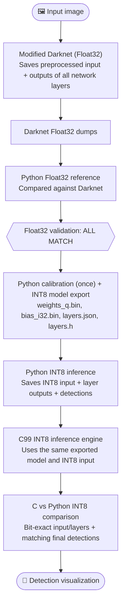

# 🚀 YOLOv3-tiny INT8 Reference and C Inference Workflow

> **Project:** `riscv-yolo-accelerator`\
> **Environment:** Ubuntu VM\
> **Project root:** `~/riscv-yolo-accelerator`

This document describes the tested host-side workflow for building and
running the modified Darknet reference, generating Python Float32 and
INT8 references, running the C99 INT8 inference engine, comparing
results, and visualizing detections.

---

## 📑 Table of Contents

1. [🧭 Workflow overview](#1--workflow-overview)
2. [🗂️ Project directory structure](#2-️-project-directory-structure)
3. [🕸️ Darknet: build and Float32 inference](#3-️-darknet-build-and-float32-inference)
4. [🐍 Python Float32 reference and Darknet comparison](#4--python-float32-reference-and-darknet-comparison)
5. [🎯 Python INT8: calibration and model export](#5--python-int8-calibration-and-model-export)
6. [🔢 Python INT8 inference on additional images](#6--python-int8-inference-on-additional-images)
7. [⚙️ C99 INT8 inference engine](#7-️-c99-int8-inference-engine)
8. [🖼️ Detection visualization](#8-️-detection-visualization)
9. [✅ Quick checklist for testing a new image](#9--quick-checklist-for-testing-a-new-image)
10. [🛠️ Troubleshooting and reminders](#10-️-troubleshooting-and-reminders)
11. [📊 Current host-side validation status](#11--current-host-side-validation-status)

---

## 1. 🧭 Workflow overview

The goal is to establish a trusted software reference before porting the
inference engine to the RISC-V E203 and integrating custom instructions
and hardware acceleration.



### 🎯 Purpose of each stage

1.  **Darknet Float32:** Provides the original model's Float32 baseline.
    A dump hook was added to `network.c` to save the input tensor after
    preprocessing and the output tensor of each layer.
2.  **Python Float32:** Provides an independent implementation of the
    forward pass. Comparing it against Darknet verifies that the Python
    reference is correct.
3.  **Calibration and INT8 export:** Activation ranges are calculated
    using a calibration image set. The model is then quantized and
    exported. Calibration is performed once for the model, not once per
    test image.
4.  **Python INT8:** Acts as the golden reference for the quantized
    model. It saves the quantized input, intermediate layer outputs, and
    final detections.
5.  **C inference:** Runs the same exported model using the same INT8
    input. Its intermediate outputs and final detections are compared
    against Python.
6.  **Visualization:** Draws the detections on the original image for
    visual inspection in addition to numerical comparison.

> [!IMPORTANT]
> Successful execution on the Ubuntu host does not mean
> that the software has already been ported to or tested on the E203.
> Cross-compilation, simulation, hardware integration, and hardware
> performance evaluation are separate future tasks.

[⬆️ Back to top](#-yolov3-tiny-int8-reference-and-c-inference-workflow)

---

## 2. 🗂️ Project directory structure

The commands in this guide use the following project layout:

``` text
riscv-yolo-accelerator/
├── docs/
├── software/
│   ├── reference/
│   │   ├── darknet/                 # Darknet source with the custom dump hook
│   │   ├── darknet_upstream/        # Separate upstream clone
│   │   ├── python/
│   │   │   └── yolov3_tiny_ref.py
│   │   └── results/
│   │       ├── darknet_float32_dog/
│   │       ├── python_float32_dog/
│   │       └── python_int8_dog/
│   ├── c_inference/
│   │   ├── src/
│   │   │   ├── yolo_int8.c
│   │   │   └── yolo_decode.c
│   │   ├── include/
│   │   ├── tests/
│   │   ├── tools/
│   │   ├── results/
│   │   │   ├── detections/
│   │   │   └── visualizations/
│   │   ├── build/
│   │   └── Makefile
│   └── datasets/
│       └── coco2017/
│           └── calib_images/        # 200 calibration images
└── hardware/
```

The commands assume that the source files, pretrained weights, test
images, and calibration dataset are already present in these locations.

### 📌 Important files

| File                  | Purpose                                     |
| --------------------- | ------------------------------------------- |
| `yolov3-tiny.cfg`     | YOLOv3-tiny network configuration           |
| `yolov3-tiny.weights` | Pretrained Darknet weights                  |
| `coco.names`          | COCO class names                            |
| `layers.json`         | Exported model and layer metadata           |
| `layers.h`            | C header generated for the exported model   |
| `weights_q.bin`       | Quantized INT8 weights                      |
| `bias_i32.bin`        | INT32 biases                                |
| `input.bin`           | Preprocessed or quantized network input     |
| `layer_XX.bin`        | Saved output tensor for layer XX            |
| `detections_int8.txt` | Python INT8 final detections                |
| `detections_c.txt`    | C engine final detections                   |

[⬆️ Back to top](#-yolov3-tiny-int8-reference-and-c-inference-workflow)

---

## 3. 🕸️ Darknet: build and Float32 inference

### 3.1 🔨 Build Darknet

Build the modified project copy for CPU-only execution:

``` bash
cd ~/riscv-yolo-accelerator/software/reference/darknet

make GPU=0 CUDNN=0 OPENCV=0
```

This should generate the executable:

``` text
software/reference/darknet/darknet
```

Check that it runs:

``` bash
./darknet
```

Darknet should print its usage information.

> [!IMPORTANT]
> Use the project copy at `software/reference/darknet`.
> Its `src/network.c` contains the custom `DUMP_DIR` hook. The separate
> `darknet_upstream` directory is an upstream reference clone and is not
> the modified executable used in this workflow.

### 3.2 🐕 Run Darknet on `dog.jpg` and dump the tensors

``` bash
cd ~/riscv-yolo-accelerator/software/reference/darknet

mkdir -p ../results/darknet_float32_dog

set -o pipefail
DUMP_DIR="$PWD/../results/darknet_float32_dog" \
./darknet detector test \
    cfg/coco.data \
    cfg/yolov3-tiny.cfg \
    yolov3-tiny.weights \
    data/dog.jpg \
    -dont_show -ext_output -thresh 0.25 \
    | tee ../results/darknet_float32_dog/darknet_dets.txt
```

The `DUMP_DIR` hook saves the network input and each layer output as
Float32 binary files.

Expected output directory:

``` text
darknet_float32_dog/
├── darknet_dets.txt
├── input.bin
├── layer_00.bin
├── layer_01.bin
├── ...
├── layer_23.bin
└── predictions.jpg
```

List the generated files:

``` bash
find ../results/darknet_float32_dog -maxdepth 1 -type f | sort
```

`input.bin` contains the exact preprocessed input tensor generated by
Darknet. It is passed to the Python reference so both implementations
start from identical input values.

### 3.3 🦅 Run Darknet on another image

Use a separate output directory for every image. For example, to run
`eagle.jpg`:

``` bash
mkdir -p ../results/darknet_float32_eagle

set -o pipefail
DUMP_DIR="$PWD/../results/darknet_float32_eagle" \
./darknet detector test \
    cfg/coco.data \
    cfg/yolov3-tiny.cfg \
    yolov3-tiny.weights \
    data/eagle.jpg \
    -dont_show -ext_output -thresh 0.25 \
    | tee ../results/darknet_float32_eagle/darknet_dets.txt
```

For `person.jpg`, replace `data/eagle.jpg` with `data/person.jpg` and
use `darknet_float32_person` as the output directory.

[⬆️ Back to top](#-yolov3-tiny-int8-reference-and-c-inference-workflow)

---

## 4. 🐍 Python Float32 reference and Darknet comparison

### 4.1 Generate the Python Float32 reference

The Python reference uses Darknet's `input.bin`. This ensures that both
implementations use exactly the same preprocessed input tensor.

``` bash
cd ~/riscv-yolo-accelerator/software/reference/python

python3 yolov3_tiny_ref.py run \
    --cfg ../darknet/cfg/yolov3-tiny.cfg \
    --weights ../darknet/yolov3-tiny.weights \
    --image ../darknet/data/dog.jpg \
    --input-bin ../results/darknet_float32_dog/input.bin \
    --names ../darknet/data/coco.names \
    --no-int8 \
    --out ../results/python_float32_dog
```

Expected output files include:

``` text
python_float32_dog/
├── detections_float.txt
└── float/
    ├── input.bin
    ├── layer_00.bin
    ├── ...
    └── layer_23.bin
```

### 4.2 🔍 Compare Python Float32 against Darknet

Run:

``` bash
python3 yolov3_tiny_ref.py compare \
    --darknet ../results/darknet_float32_dog \
    --ref ../results/python_float32_dog/float
```

Expected successful result:

``` text
ALL MATCH
```

This verifies the Python Float32 forward pass against the modified
Darknet implementation. The input and layer outputs should match within
the comparison tolerance used by the script.

[⬆️ Back to top](#-yolov3-tiny-int8-reference-and-c-inference-workflow)

---

## 5. 🎯 Python INT8: calibration and model export

### 5.1 Generate the INT8 model

The calibration dataset contains 200 images. Run calibration and model
export as follows:

``` bash
cd ~/riscv-yolo-accelerator/software/reference/python

python3 yolov3_tiny_ref.py run \
    --cfg ../darknet/cfg/yolov3-tiny.cfg \
    --weights ../darknet/yolov3-tiny.weights \
    --image ../darknet/data/dog.jpg \
    --input-bin ../results/darknet_float32_dog/input.bin \
    --names ../darknet/data/coco.names \
    --calib-dir ../../datasets/coco2017/calib_images \
    --bits 8 \
    --out ../results/python_int8_dog
```

The script runs the Float32 reference, calibrates activation ranges,
quantizes the model, and exports the INT8 model.

Expected key outputs:

``` text
python_int8_dog/
├── detections_float.txt
├── detections_int8.txt
├── report.txt
├── float/
│   ├── input.bin
│   └── layer_XX.bin ...
├── int8/
│   ├── input.bin
│   ├── layer_00.bin
│   ├── ...
│   └── layer_22.bin
└── model/
    ├── layers.json
    ├── layers.h
    ├── weights_q.bin
    └── bias_i32.bin
```

Some layer indices, such as 16 and 23, are metadata/YOLO output layers
and do not have ordinary INT8 layer dump files in the current
implementation. This is expected.

> [!IMPORTANT]
> Keep the exported `model/` directory unchanged and reuse
> it for all additional test images. Do not recalibrate separately for
> eagle or person if the goal is to evaluate the same fixed INT8 model
> across multiple images.

[⬆️ Back to top](#-yolov3-tiny-int8-reference-and-c-inference-workflow)

---

## 6. 🔢 Python INT8 inference on additional images

Use `infer-int8` to load the previously exported model and run inference
on a new image. This command does not recalibrate or export another
model.

### 6.1 🦅 Eagle

``` bash
cd ~/riscv-yolo-accelerator/software/reference/python

python3 yolov3_tiny_ref.py infer-int8 \
    --cfg ../darknet/cfg/yolov3-tiny.cfg \
    --weights ../darknet/yolov3-tiny.weights \
    --model ../results/python_int8_dog/model \
    --image ../darknet/data/eagle.jpg \
    --names ../darknet/data/coco.names \
    --out ../results/python_int8_eagle
```

### 6.2 🧍 Person

``` bash
python3 yolov3_tiny_ref.py infer-int8 \
    --cfg ../darknet/cfg/yolov3-tiny.cfg \
    --weights ../darknet/yolov3-tiny.weights \
    --model ../results/python_int8_dog/model \
    --image ../darknet/data/person.jpg \
    --names ../darknet/data/coco.names \
    --out ../results/python_int8_person
```

A successful run should include messages similar to:

``` text
Loaded INT8 model from ...
INT8 forward using saved quantization parameters ...
...
No calibration or model export was performed.
```

Each image-specific output directory should contain:

``` text
python_int8_<image>/
├── detections_int8.txt
└── int8/
    ├── input.bin
    ├── layer_00.bin
    ├── ...
    └── layer_22.bin
```

For another image, change `--image` and `--out`. Keep `--model` pointing
to the original calibrated model.

[⬆️ Back to top](#-yolov3-tiny-int8-reference-and-c-inference-workflow)

---

## 7. ⚙️ C99 INT8 inference engine

### 7.1 Build and run C inference

The host test harness reads:

-   The exported model (`weights_q.bin`, `bias_i32.bin`, and
    `layers.h`).
-   The INT8 input tensor generated by Python.
-   The Python INT8 layer dumps, which are used for bit-exact
    validation.

Run C inference on dog:

``` bash
cd ~/riscv-yolo-accelerator/software/c_inference

make test \
  MODEL=../reference/results/python_int8_dog/model \
  INPUT=../reference/results/python_int8_dog/int8/input.bin \
  REF=../reference/results/python_int8_dog/int8
```

Run C inference on eagle:

``` bash
make test \
  MODEL=../reference/results/python_int8_dog/model \
  INPUT=../reference/results/python_int8_eagle/int8/input.bin \
  REF=../reference/results/python_int8_eagle/int8
```

Run C inference on person:

``` bash
make test \
  MODEL=../reference/results/python_int8_dog/model \
  INPUT=../reference/results/python_int8_person/int8/input.bin \
  REF=../reference/results/python_int8_person/int8
```

The Makefile builds the host executable when needed and runs it. The
default detection output is:

``` text
software/c_inference/results/detections/detections_c.txt
```

> [!WARNING]
> Every `make test` run overwrites `detections_c.txt`. Copy
> the result to an image-specific filename immediately after each run if
> you want to preserve it.

For dog:

``` bash
cp results/detections/detections_c.txt \
   results/detections/detections_dog_int8.txt
```

For eagle and person, use `detections_eagle_int8.txt` and
`detections_person_int8.txt`, respectively.

### 7.2 ✅ Expected successful C output

A successful run should report:

-   `input format: INT8 (already quantized)`
-   `input bit-exact`
-   Every compared layer marked `bit-exact`
-   Forward execution time
-   Decoded detections and `dropped=0` when no entries overflow the
    configured detection buffer
-   Final status:

``` text
ALL LAYERS BIT-EXACT
```

The current host engine uses a static feature-map arena. The observed
peak arena usage for this model was approximately 3.30 MiB, in addition
to model weights and input storage.

> [!NOTE]
> Host execution time is a software-host measurement. It is **not** an
> E203 performance result.

### 7.3 🔬 Compare C detections against Python INT8

After preserving the C output, compare it against the corresponding
Python INT8 detection file.

Dog:

``` bash
python3 tests/compare_dets.py \
  --c results/detections/detections_dog_int8.txt \
  --ref ../reference/results/python_int8_dog/detections_int8.txt \
  --names ../reference/darknet/data/coco.names \
  --thresh 0.25
```

Eagle:

``` bash
python3 tests/compare_dets.py \
  --c results/detections/detections_eagle_int8.txt \
  --ref ../reference/results/python_int8_eagle/detections_int8.txt \
  --names ../reference/darknet/data/coco.names \
  --thresh 0.25
```

Person:

``` bash
python3 tests/compare_dets.py \
  --c results/detections/detections_person_int8.txt \
  --ref ../reference/results/python_int8_person/detections_int8.txt \
  --names ../reference/darknet/data/coco.names \
  --thresh 0.25
```

Expected successful ending:

``` text
RESULT: PASS
```

The comparison reports the number of detections, matched detections,
probability difference, bounding-box coordinate difference, and
unmatched detections.

[⬆️ Back to top](#-yolov3-tiny-int8-reference-and-c-inference-workflow)

---

## 8. 🖼️ Detection visualization

The generic visualizer accepts the original image, a detection text
file, the COCO class names file, and an output path.

Run these commands from `software/c_inference`.

### 🐕 Dog

``` bash
python3 tests/visualize_dets.py \
  --image ../reference/darknet/data/dog.jpg \
  --detections results/detections/detections_dog_int8.txt \
  --names ../reference/darknet/data/coco.names \
  --output results/visualizations/dog_int8.jpg
```

### 🦅 Eagle

``` bash
python3 tests/visualize_dets.py \
  --image ../reference/darknet/data/eagle.jpg \
  --detections results/detections/detections_eagle_int8.txt \
  --names ../reference/darknet/data/coco.names \
  --output results/visualizations/eagle_int8.jpg
```

### 🧍 Person

``` bash
python3 tests/visualize_dets.py \
  --image ../reference/darknet/data/person.jpg \
  --detections results/detections/detections_person_int8.txt \
  --names ../reference/darknet/data/coco.names \
  --output results/visualizations/person_int8.jpg
```

Expected message:

``` text
Saved visualization: ...
```

Open a generated image in the Ubuntu desktop:

``` bash
xdg-open results/visualizations/dog_int8.jpg
```

The visualizer draws bounding boxes and class/probability labels. It
does not run inference; it only displays detections that have already
been generated by the C engine.

[⬆️ Back to top](#-yolov3-tiny-int8-reference-and-c-inference-workflow)

---

## 9. ✅ Quick checklist for testing a new image

Once the INT8 model has been calibrated and exported, the repeatable
process for each new image is:

1.  **Python INT8 inference:** Run `infer-int8` using the existing
    `python_int8_dog/model`.
2.  **C inference:** Run `make test` with that image's `int8/input.bin`
    and `int8/` reference directory.
3.  **Preserve C detections:** Copy `detections_c.txt` to an
    image-specific filename.
4.  **Compare detections:** Run `tests/compare_dets.py` against that
    image's `detections_int8.txt`.
5.  **Visualize:** Run `tests/visualize_dets.py`.

You do not need to rebuild Darknet, rerun Float32 inference, or
recalibrate the model for every new image. Those steps are only required
when rebuilding the reference pipeline or creating a new calibrated INT8
model.

[⬆️ Back to top](#-yolov3-tiny-int8-reference-and-c-inference-workflow)

---

## 10. 🛠️ Troubleshooting and reminders

-   **Wrong working directory:** Commands use relative paths. Run the
    relevant `cd` command before executing them.
-   **Missing Darknet executable:** Rebuild using
    `make GPU=0 CUDNN=0 OPENCV=0`.
-   **Missing Darknet dump files:** Check that `DUMP_DIR` points to the
    intended output directory and that you are running the modified
    `software/reference/darknet` copy.
-   **Missing Python model files:** Run the calibration/export command
    in Section 5 before using `infer-int8`.
-   **C detections unexpectedly changed:** Remember that `make test`
    overwrites `results/detections/detections_c.txt`. Preserve each
    image's output before running the next test.
-   **Model/reference mismatch:** Use the same calibrated model
    directory for the C run and the Python INT8 reference that generated
    that image's tensors.
-   **Avoid deleting old results:** Result directories contain golden
    inputs, layer dumps, and detection outputs that are useful for
    debugging and regression testing.
-   **Do not recalibrate for every image:** Reuse the same exported
    model to keep quantization parameters fixed across the test set.

[⬆️ Back to top](#-yolov3-tiny-int8-reference-and-c-inference-workflow)

---

## 11. 📊 Current host-side validation status

The following host-side tests have been completed in the current project
workflow:

| Image    | Python INT8 inference | C input/layer comparison                                   | C vs Python detections            |
| -------- | --------------------- | ---------------------------------------------------------- | --------------------------------- |
| 🐕 dog    | ✅ Completed          | ✅ `ALL LAYERS BIT-EXACT`                                  | ✅ `PASS` — 6 matched             |
| 🦅 eagle  | ✅ Completed          | ✅ `ALL LAYERS BIT-EXACT`                                  | ✅ `PASS` — 1 matched             |
| 🧍 person | ✅ Completed in Python | C run and comparison should be confirmed from the latest terminal output | Confirm from terminal output |

For dog and eagle, the C-vs-Python comparison reported zero displayed
probability difference and zero bounding-box coordinate difference.

> [!NOTE]
> **Scope of these results:** These are host-side Darknet/Python/C
> reference validation results only. E203 cross-compilation, simulation,
> NICE/custom-instruction integration, FPGA execution, and hardware
> performance measurement are separate future tasks.

[⬆️ Back to top](#-yolov3-tiny-int8-reference-and-c-inference-workflow)
